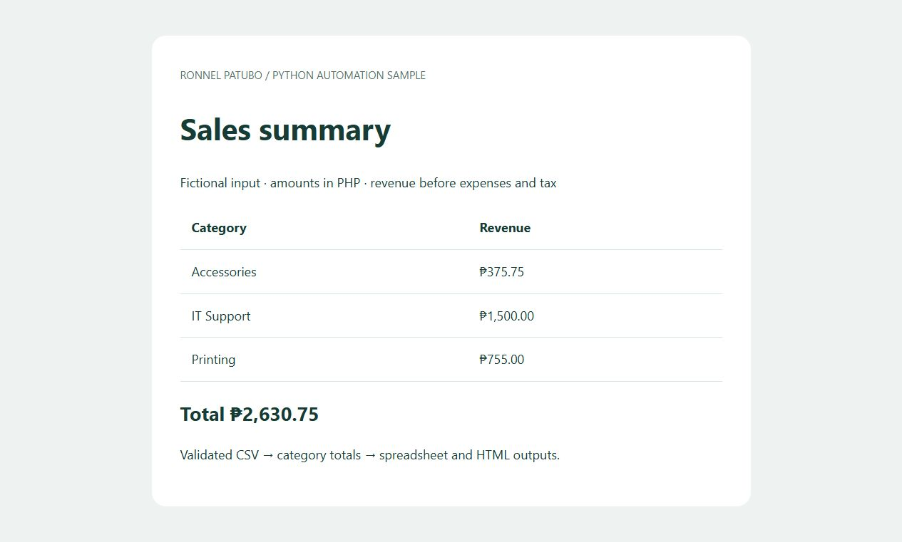
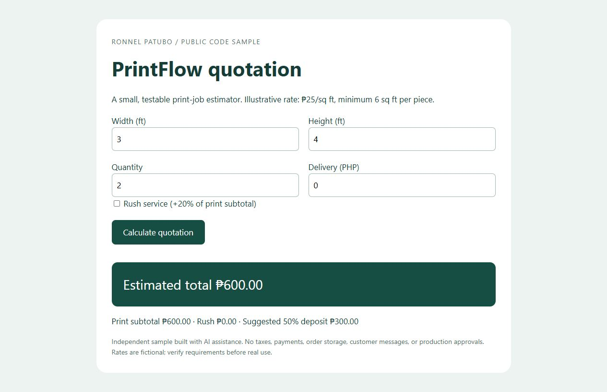
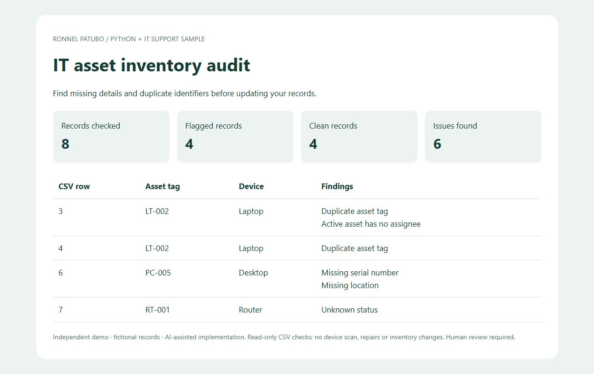

# Ronnel Patubo — practical software samples

Small, reproducible examples for freelance IT, software and automation work.
These are independent portfolio demonstrations with fictional data, not paid-client results.

## 1. Python sales-report automation

Validates a CSV, groups revenue by category with decimal arithmetic, and exports an Excel-readable CSV plus a standalone HTML report. Rejects invalid rows and protects output CSV category labels from formula interpretation.



Python 3.10+; no third-party dependencies. From this repository's root:

```sh
python csv-report/report.py csv-report/sample.csv --output-dir output/sales
python -m unittest discover -s csv-report -p "test_*.py" -v
```

Open `output/sales/report.html` in your browser. Expected total: **PHP 2,630.75** across three categories. To repeat the command, choose a fresh output folder. Input stays on your computer; no network service is used.

## 2. PrintFlow quotation sample

A standalone browser estimator inspired by the Likhora print-shop workflow. Uses integer-cent totals, a per-piece area minimum, optional rush charge, delivery, and a suggested deposit. This small implementation is separate from the private Likhora application.



Python is used only to serve static files; Node.js 22+ runs the calculation tests:

```sh
python -m http.server 8080 --bind 127.0.0.1
node --test printflow/quote.test.mjs
```

Open **http://127.0.0.1:8080/printflow/**. Do not open the HTML as a file: ES modules need HTTP. Stop the server with Ctrl+C. Default quote: two 3 × 4 ft pieces at an illustrative PHP 25/sq ft = **PHP 600**, with a suggested PHP 300 deposit.

## 3. IT asset inventory checker

Flags missing asset information, duplicate tags/serials and invalid statuses in a CSV export. Produces a readable HTML audit and machine-readable findings without changing the input or scanning devices.



```sh
python asset-check/check_inventory.py asset-check/sample.csv --output-dir output/assets
python -m unittest discover -s asset-check -p "test_*.py" -v
```

Python 3.10+, no dependencies. Expected demo: eight records, four flagged records and six findings. See [rules, limits and contribution notes](asset-check/README.md).

## What these samples demonstrate

- Validating business inputs before generating results.
- Keeping calculation logic separate from the browser interface.
- Producing reports a nontechnical user can review.
- Testing money calculations, malformed inputs and repeat-run behavior.

## Contribution and provenance

**Ronnel Patubo:** project owner and portfolio subject; supplied his professional background and Likhora business context, requested these samples, and directs which work represents his services. His experience includes IT support, C#/Python/SQL development and hardware/software integration.

**AI assistance:** Codex authored the new sample code, documentation and tests for this portfolio preparation, executed the checks, and captured the screenshots. These additions do not claim that Ronnel independently wrote every line or that they were delivered to a paying client. A client can ask him to walk through and adapt a sample to evaluate his understanding.

Existing professional experience and these new demonstrations are separate evidence. No customer outcomes, certifications or revenue gains are implied.

## Limits

The sales report is revenue aggregation, not accounting or tax software. The quote is an illustrative estimator, without production tax rules, authentication, saved orders, customer messaging or payment processing. Review business rules before real use. Repository licensing has not been assigned; contact the owner about reuse.

## Related project

[Vietnam Adventure Publisher](https://github.com/ronnel0716/VietnamAdventurePublisher) demonstrates a DOCX-to-HTML/JSON document pipeline. Likhora's full application source remains private; no credentials, business records or private source are included here.
